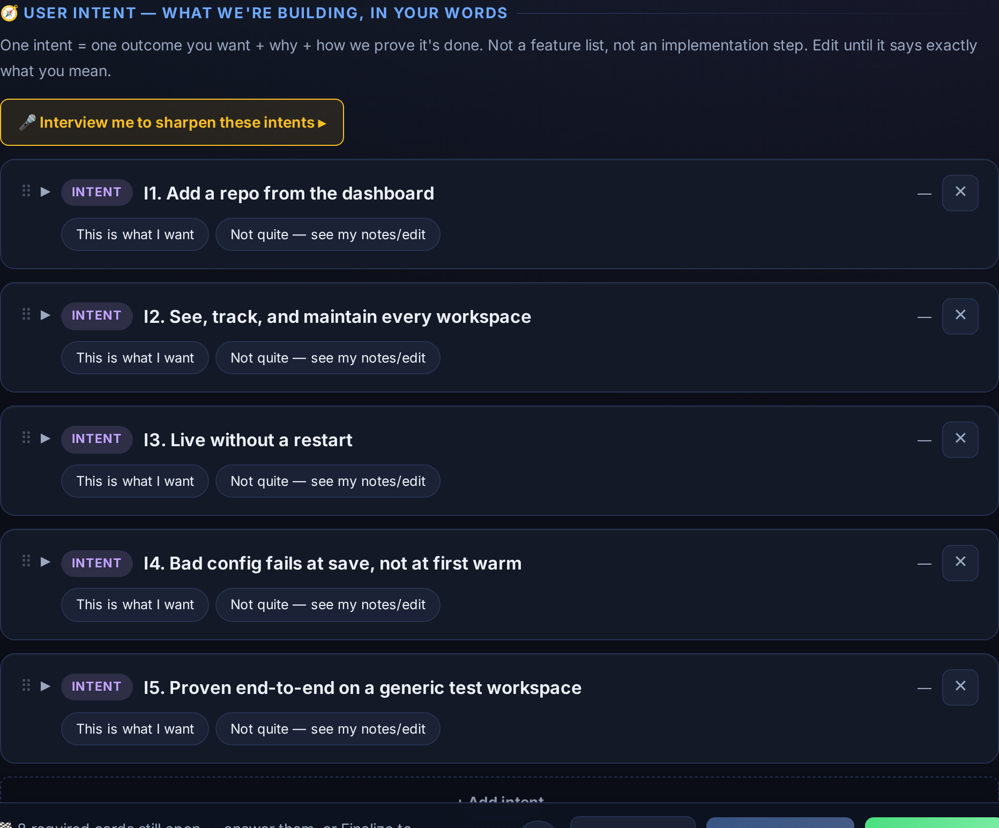
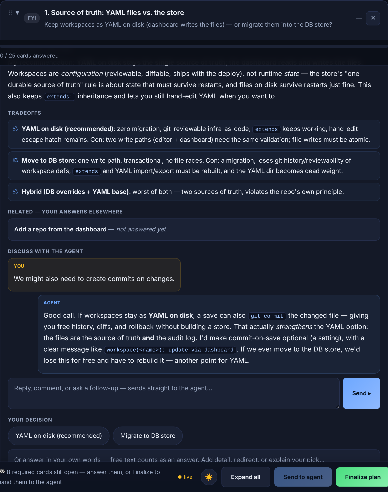
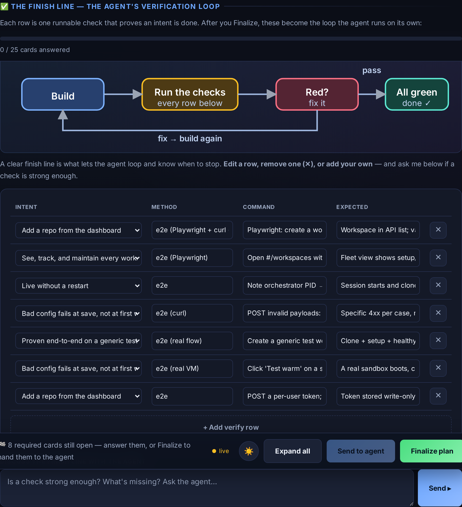

# plan-html

**Stop approving plans you didn't read.**

Your coding agent writes its plan as a wall of markdown. You skim it, approve
it, and find out later that it misunderstood you. plan-html turns that plan into
a page in your browser: what the agent understood, the choices it needs from
you, what it will not touch, and how it will prove the work is done. You answer
with a click or in your own words, ask a question on any card, and the agent
builds only once you both agree.

Works with **Claude Code**, **Codex** and **Pi**. Runs on your machine, no
dependencies, MIT.


## Try it in one minute

In Claude Code:

```text
/plugin marketplace add DoryZi/plan-html
/plugin install plan-html
```

Restart Claude Code, then:

```text
/plan-html add a dark mode toggle to the settings page
```

The plan opens in your browser. Using Codex or Pi, or want a plain clone? See
[Install](#install).

🎬 [One minute intro](https://github.com/DoryZi/plan-html/releases/download/v0.3.0/plan-html-intro.mp4) · ▶ [Full demo on YouTube](https://youtu.be/cFwvulWoTE4) · 📖 [Why I built it](https://doryzidon.com/blog/stop-approving-plans-you-didnt-read)

## What it looks like



| | |
|---|---|
|  |  |
| _A decision card: options, tradeoffs, and a live back-and-forth with the agent right inside the card._ | _The finish line: a verification loop and the acceptance criteria that prove the plan is done._ |

## Features

- **Design in the same round**: when the UI matters, a question shows 2 or 3 options as strips of mock screens; open any of them full size, click through it, and pin notes to its elements.
- **Easy to scan**: sections fold from their headings, a menu lists the sections with what is left in each, answered cards fold away, and "Show what's left" hides everything you already answered.
- **Reshapeable**: add, edit, strike and drag-reorder cards, steps, and finish-line rows; your changes are authoritative and ride back to the agent.
- **Live answers**: ask a card a question and the agent's reply streams back into it (SSE), with the answer written into the plan so it survives a dropped connection.
- **Works remotely**: serve on your LAN or behind a tunnel; an adaptive polling fallback keeps updates flowing even through proxies that buffer SSE.
- **Finalize on your terms**: finalize early and let the agent decide what's unanswered (with a confirm), or loop until everything's pinned.
- **Autosaves everything**: every answer is persisted next to the plan; an interrupted session loses nothing.
- **Zero dependencies to run**: stdlib Python server, single offline `deck.html`. No build step, no CDN.

## What's here

| Path | What it is |
|------|------------|
| `serve_plan.py` | The server. Renders `plan.json` into the deck, serves it on `127.0.0.1`, autosaves answers, streams plan changes over SSE (`--live`), and prints each round to stdout. Zero dependencies (stdlib only). |
| `templates/deck.html` | The deck: a single self-contained, offline HTML file, hand-edited. Its JavaScript is organized into a few labeled top-level `<script>` blocks that run in document order and share one global scope. No build step, no modules, no CDN. |
| `scripts/lint-deck.js` | Extracts the deck's inline `<script>` blocks into a temp file and runs ESLint over them. |
| `templates/proto-kit.js` | The small script a mock or prototype screen loads so the deck can open it full size, step through it and pin notes to it. |
| `finalize_plan.py` | Writes the final `plan.md` (every card, its answer and discussion, the steps and checks) when you finalize. |
| `cycles.py` | Makes and lists the dated cycle folders (`cycles/YYYY-MM-DD-NN-<slug>/`) plans are kept in. |
| `check_prototype.py` | Clicks through a plan's mock screens or prototype in a headless browser and reports dead controls (needs `pip install playwright`). |
| `examples/` | Two worked plans: `mocks/` (a design question answered with mock screens) and `prototype/` (a clickable prototype). |
| `tests/` | pytest: server unit and HTTP tests, and browser tests of the deck on the examples. `tests/e2e`: Playwright (JS) browser tests. |

## Install

plan-html is a **Claude Code skill**: install it once and your agent invokes it
whenever you ask to plan something interactively.

**Option A: plugin marketplace (easiest):**

```text
/plugin marketplace add DoryZi/plan-html
/plugin install plan-html
```

Restart Claude Code, then just ask it to plan a feature. It picks up `/plan-html`
automatically.

**Option B: clone into your skills directory:**

```bash
# user-level (available in every project)
git clone https://github.com/DoryZi/plan-html ~/.claude/skills/plan-html

# or project-level (just this repo)
git clone https://github.com/DoryZi/plan-html .claude/skills/plan-html
```

Claude Code auto-discovers any skill under `.claude/skills/`, so `/plan-html`
is available the next time you start it. No build step and nothing to compile:
the server is stdlib Python and the deck is a single offline HTML file.

**Option C: Codex or Pi.** Clone into the folder each one reads skills from:

```bash
git clone https://github.com/DoryZi/plan-html ~/.agents/skills/plan-html      # Codex
git clone https://github.com/DoryZi/plan-html ~/.pi/agent/skills/plan-html    # Pi
```

**Requirements:** Python ≥ 3.10. (Node is only needed to run the dev/lint/test
tooling, not to use the skill.)

> Want to drive the server by hand, without an agent? Skip straight to
> [Quick start](#quick-start).

## Quick start

```bash
# serve a plan (no Node needed to run: the deck is a single offline HTML file)
python3 serve_plan.py --plan /abs/path/to/plan.json --live
```

The deck opens in your browser. Work through the cards; answers autosave to
`answers.json` next to the plan. Click **Send to agent** to ship a round, or
**Finalize** when you're done.

### Phone / remote access

```bash
python3 serve_plan.py --plan plan.json --host 0.0.0.0   # LAN
# or expose a running deck publicly with a tunnel:
cloudflared tunnel --url http://localhost:<port>
```

Live updates use SSE, with an automatic polling fallback for environments that
buffer event streams (Cloudflare quick-tunnels do this), so the deck stays in
sync over a tunnel even when the live push can't get through. Pass a fixed
`--port` when tunnelling so the public URL survives a server restart.

## Develop

The deck is a single hand-edited offline HTML file (no CDN, opens with
`file://`). Edit `templates/deck.html` directly: its JavaScript lives in a few
labeled top-level `<script>` blocks (markdown/dom helpers, state, cards,
sections, live + main entry) that run in document order and share one global
scope. There is no build step.

```bash
npm install
npm run lint         # eslint over the deck's inline JS (extracted)
npm run test:e2e     # Playwright browser e2e (needs Chromium)
npm test             # lint + Playwright e2e
```

```bash
# Python server tests
pip install -e ".[test]"
pytest               # HTTP e2e + unit
```

CI runs lint and the Python suite on every push; the Playwright suite runs when
a browser is available.

## License

MIT © Dory Zidon

## About

Built by [Dory Zidon](https://doryzidon.com). I use it to plan my own
builds. If it saves you from one bad plan, a star helps other people find it.
Bugs and ideas are welcome in [Issues](https://github.com/DoryZi/plan-html/issues).
