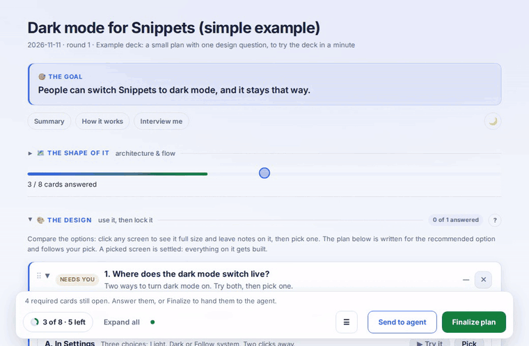
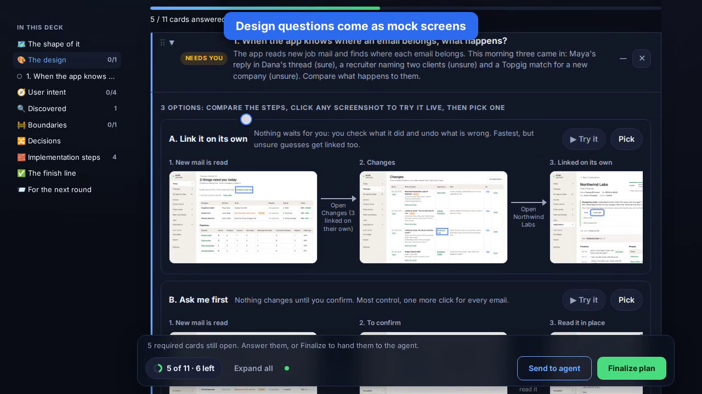
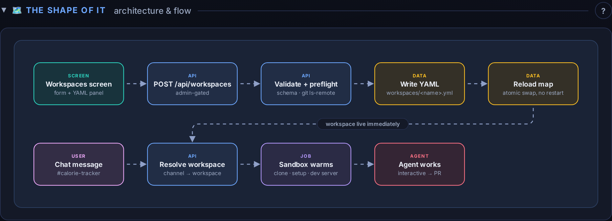
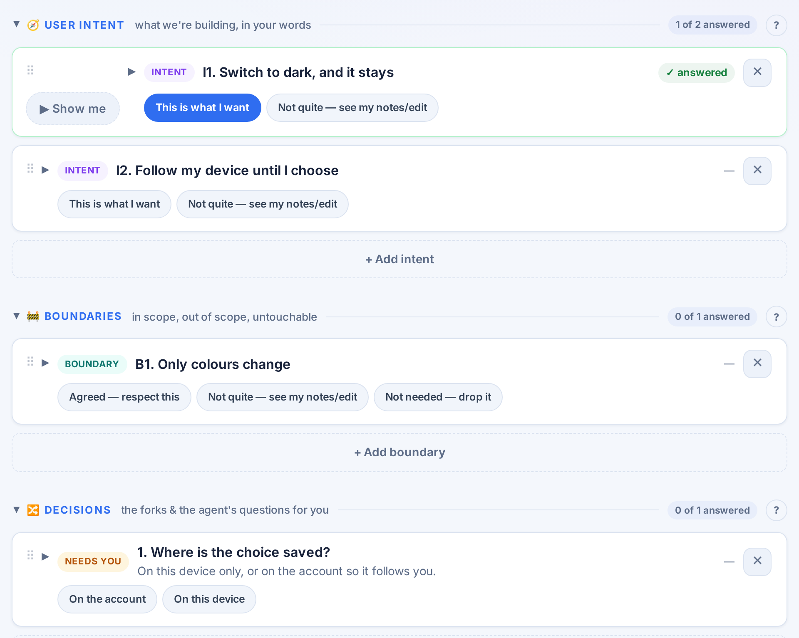

# plan-html

**See how it will work before your agent spends 12 hours building it.**

**[Install](#install)** · [Try a ready-made plan](#try-it-without-an-agent) · [Demo on YouTube](https://youtu.be/cFwvulWoTE4) · [Why I built it](https://doryzidon.com/blog/stop-approving-plans-you-didnt-read)



plan-html turns your coding agent's plan into a page in your browser. You click
through mock screens of the app, answer the open questions and fix what it got
wrong, all before it writes any code.

Works with **Claude Code**, **Codex**, **Cursor** and **Pi**. Runs on your
machine, MIT.

> "As Claude takes on more, I'd noticed I was reading plans less closely, and I
> wanted a way to stay engaged with its choices rather than just hand them off."
>
> Thariq Shihipar, Anthropic, in [The Unreasonable Effectiveness of HTML](https://claude.com/blog/using-claude-code-the-unreasonable-effectiveness-of-html)

⭐ **If this is useful to you, please star the repo.** It is how other people find it.

## Install

In Claude Code:

```text
/plugin install plan-html --marketplace DoryZi/plan-html
```

Restart Claude Code, then ask for a plan:

```text
/plan-html add a dark mode toggle to the settings page
```

The plan opens in your browser. Needs Python 3.10 or later, nothing else.

<details>
<summary><b>Codex, Cursor, Pi, older Claude Code, or a plain clone</b></summary>

**Claude Code before 2.1.275:**

```text
/plugin marketplace add DoryZi/plan-html
/plugin install plan-html
```

**Clone it as a skill.** Each tool finds skills in its own folder:

```bash
git clone https://github.com/DoryZi/plan-html ~/.claude/skills/plan-html      # Claude Code, every project
git clone https://github.com/DoryZi/plan-html .claude/skills/plan-html        # Claude Code, this repo only
git clone https://github.com/DoryZi/plan-html ~/.agents/skills/plan-html      # Codex
git clone https://github.com/DoryZi/plan-html ~/.pi/agent/skills/plan-html    # Pi
```

Node is only needed for the lint and test tooling, not to use the skill.

</details>

## Try it without an agent

Open a small ready-made plan (dark mode for a notes app):

```bash
git clone https://github.com/DoryZi/plan-html && cd plan-html
python3 serve_plan.py --plan examples/dark-mode/plan.json
```

It opens in your browser. Click the mock screens, pick an option, answer a few
cards.

## See both sides before it builds

**The front end: play with the app before it exists.** When the UI matters, the
agent draws 2 or 3 versions as mock screens. Open any of them full size, click
through it, pin a note to a button, and pick the one you want.



**The back end: see how it flows.** Every plan opens with a diagram of what
happens behind the screens, from the first request to the last step. Click a
box and the card that decides it opens.



Screens and flows in one plan, so you check the work end to end. You find out it
is wrong in a minute, not after the build.

## What you settle before it builds

| | |
|---|---|
| **Intent** | What you actually want. The agent writes down what it understood, and you correct it. |
| **Boundaries** | What it must respect and what it must not touch. |
| **Decisions** | The forks in the design. Decide them yourself, or leave any of them to the agent. |
| **Steps and the finish line** | The workflow it will follow, and the checks that prove the work is done. |



It is still iterative development. Each round is just a few clicks, and once you
finalize you can send the agent off on a long build and get back what you asked
for.

## Why the plan matters

The plan shapes what you get back more than anything else you give the agent.

- **Spec and design in one step.** Two steps of Anthropic's SDLC playbook, done together in one planning tool.
- **Fewer tokens, better input.** You answer focused questions, so your words go where they count.
- **Less variance.** A tight plan narrows what the agent can get wrong, even when your CLAUDE.md or AGENTS.md is weak.
- **Coming next:** verification loops built into the plan.

## Also in the box

- **Answer your way.** Click a button or type your own words. Ask a question on any card and the agent replies in place.
- **Change the plan yourself.** Add, edit, remove and reorder cards and steps.
- **Nothing gets lost.** Every answer autosaves, so an interrupted session picks up where it stopped.
- **Works from your phone.** Serve it on your network or through a tunnel.
- **Nothing to set up.** Plain Python and one offline HTML file. No build step.

<details>
<summary><b>Run the server by hand, or from your phone</b></summary>

```bash
# serve a plan (no Node needed to run: the deck is a single offline HTML file)
python3 serve_plan.py --plan /abs/path/to/plan.json --live
```

The deck opens in your browser. Work through the cards; answers autosave to
`answers.json` next to the plan. Click **Send to agent** to ship a round, or
**Finalize** when you're done.

### Phone / remote access

```bash
python3 serve_plan.py --plan plan.json --host 0.0.0.0   # LAN
# or expose a running deck publicly with a tunnel:
cloudflared tunnel --url http://localhost:<port>
```

Live updates use SSE, with an automatic polling fallback for environments that
buffer event streams (Cloudflare quick-tunnels do this), so the deck stays in
sync over a tunnel even when the live push can't get through. Pass a fixed
`--port` when tunnelling so the public URL survives a server restart.

</details>

<details>
<summary><b>What is in the repo</b></summary>

| Path | What it is |
|------|------------|
| `serve_plan.py` | The server. Renders `plan.json` into the deck, serves it on `127.0.0.1`, autosaves answers, streams plan changes over SSE (`--live`), and prints each round to stdout. Zero dependencies (stdlib only). |
| `templates/deck.html` | The deck: a single self-contained, offline HTML file, hand-edited. Its JavaScript is organized into a few labeled top-level `<script>` blocks that run in document order and share one global scope. No build step, no modules, no CDN. |
| `scripts/lint-deck.js` | Extracts the deck's inline `<script>` blocks into a temp file and runs ESLint over them. |
| `templates/proto-kit.js` | The small script a mock or prototype screen loads so the deck can open it full size, step through it and pin notes to it. |
| `finalize_plan.py` | Writes the final `plan.md` (every card, its answer and discussion, the steps and checks) when you finalize. |
| `cycles.py` | Makes and lists the dated cycle folders (`cycles/YYYY-MM-DD-NN-<slug>/`) plans are kept in. |
| `check_prototype.py` | Clicks through a plan's mock screens or prototype in a headless browser and reports dead controls (needs `pip install playwright`). |
| `examples/` | Two worked plans: `mocks/` (a design question answered with mock screens) and `prototype/` (a clickable prototype). |
| `tests/` | pytest: server unit and HTTP tests, and browser tests of the deck on the examples. `tests/e2e`: Playwright (JS) browser tests. |

</details>

<details>
<summary><b>Develop and test</b></summary>

The deck is a single hand-edited offline HTML file (no CDN, opens with
`file://`). Edit `templates/deck.html` directly: its JavaScript lives in a few
labeled top-level `<script>` blocks (markdown/dom helpers, state, cards,
sections, live + main entry) that run in document order and share one global
scope. There is no build step.

```bash
npm install
npm run lint         # eslint over the deck's inline JS (extracted)
npm run test:e2e     # Playwright browser e2e (needs Chromium)
npm test             # lint + Playwright e2e
```

```bash
# Python server tests
pip install -e ".[test]"
pytest               # HTTP e2e + unit
```

CI runs lint and the Python suite on every push; the Playwright suite runs when
a browser is available.

</details>

## License

MIT © Dory Zidon

## About

Built by [Dory Zidon](https://doryzidon.com). I use it to plan my own
builds.
Bugs and ideas are welcome in [Issues](https://github.com/DoryZi/plan-html/issues).
